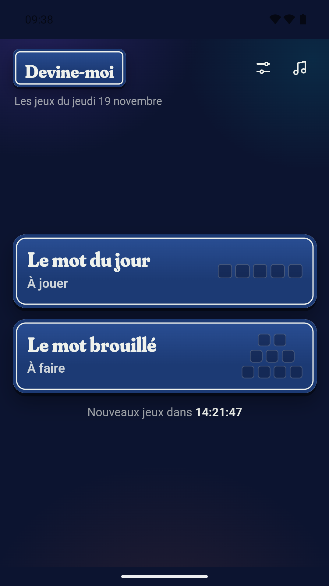
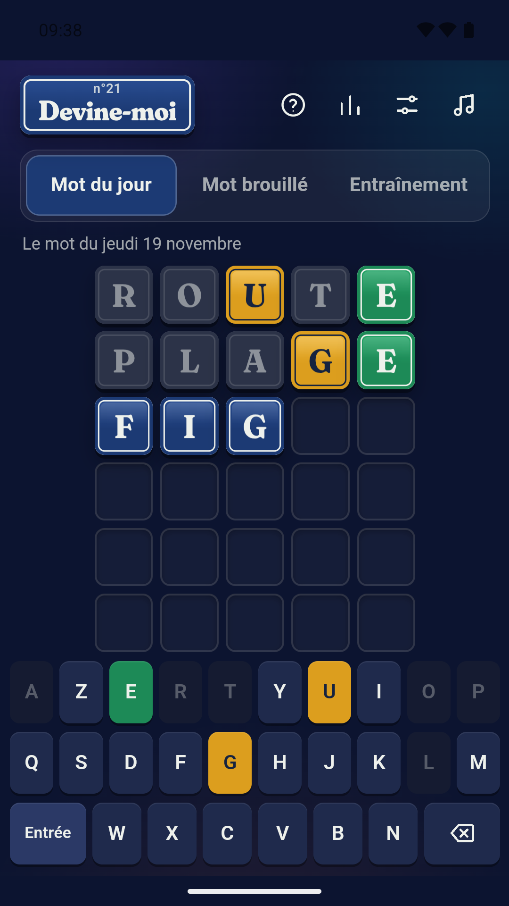
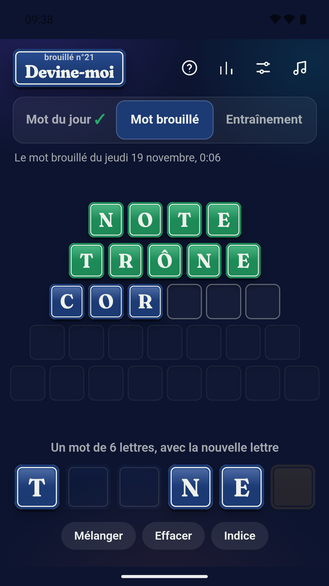

# Devine-moi

**FR** — Deux jeux de lettres en français, nouveaux chaque jour à minuit, les mêmes pour tous. **Le mot du jour** : un mot de cinq lettres à trouver en six essais (vert : bonne lettre, bonne place ; ambre : la lettre est ailleurs dans le mot ; gris : elle n'y est pas), avec un entraînement illimité en 5, 6 ou 7 lettres. **Le mot brouillé** : des lettres à remettre dans l'ordre ; on part de quatre lettres, chaque mot trouvé en apporte une de plus, jusqu'à huit, puis un mot bonus de neuf lettres. Clavier AZERTY, QWERTZ ou QWERTY, choisi selon la langue du téléphone (QWERTZ en Suisse romande, AZERTY en France et en Belgique) ou à la main dans les réglages. Sans pub, sans compte, sans connexion, sans autorisation.

**EN** — Two French word games a day: guess the five-letter word of the day in six tries (with unlimited practice in 5, 6 or 7 letters), and unscramble a ladder of words from four to eight letters, each one a letter longer, plus a nine-letter bonus word. No ads, no account, no connection, no permission. The interface is in French.

  

## Installation

- **F-Droid** (recommandé, mises à jour automatiques) : ajoutez le dépôt `https://funkypitt.github.io/fdroid-repo/repo` (ou depuis [gallaz.ch/eink](https://gallaz.ch/eink/#fdroid)).
- **Obtainium** : ajoutez `https://github.com/funkypitt/devine-moi`.
- **APK** : joint à la [dernière version](../../releases/latest).

Les trois livrent le même fichier, avec la même signature.

## Le choix des mots

C'est le cœur des deux jeux. Les réponses du mot du jour sont tirées de [Lexique 3](http://www.lexique.org), choisies à la main selon ces principes :

- des mots courants (fréquence minimale dans les films et les livres) ;
- des formes de dictionnaire : nom au singulier, adjectif au masculin singulier, infinitif, adverbe, mots grammaticaux (CETTE, SELON, PARMI, VINGT) ;
- les féminins irréguliers (BELLE, DOUCE, SÈCHE) et les pluriels irréguliers en -x (CIEUX, CHOUX) ; jamais de pluriel en -s, de féminin régulier ni de conjugaison ;
- ni noms propres, ni grossièretés, ni anglicismes à l'orthographe piégeuse (`tools/blocklist_fr.json`) ;
- un mélange déterministe où l'initiale ne se répète pas sur cinq jours.

Les essais acceptés sont bien plus larges : toutes les formes du français, conjugaisons et pluriels compris (Lexique + formes Dicollecte de l'inventaire Plume).

L'ordre des mots du jour est figé dans `words-fr.js`. Pour retirer un mot sans décaler les autres jours : l'ajouter à `tools/blocklist_fr.json`, puis `python3 tools/build_words.py --append` (il est remplacé à la même position). `python3 tools/review_words.py` affiche les 90 prochains mots.

Le mot brouillé suit la même idée (`tools/make_brouille.py`, toujours depuis Lexique) : les six mots d'une échelle sont des mots courants, jamais le mot précédent avec une lettre collée au bout, jamais deux mots de la même famille ; tout autre mot du dictionnaire fait des mêmes lettres est accepté. L'ordre des échelles est figé dans `brouille-data.js` ; le script le remélange à chaque passage, donc épingler dans `PINNED` les jours déjà joués avant de le relancer.

## Build

Capacitor (Android) autour d'une app web en HTML/JS sans dépendance.

```
npm install
./build.sh            # tests, www/, cap sync, APK signé → Devine-moi-vX.Y.Z.apk
```

La signature lit `android/keystore.properties` (hors git : `storeFile`, `storePassword`, `keyAlias`, `keyPassword`). Pour développer : `python3 -m http.server` puis `http://localhost:8000/?day=2026-11-03&reset=1`.

`devine-core.js` (règles, testées par `node --test tests/*.test.js`), `devine-ui.js` + `devine-ui.css` (plaques et clavier) et `words-fr.js` sont partagés avec le module Devine-moi de [Funky's 2P Games](https://github.com/funkypitt/local-2p-games).

## Crédits

Mots : Lexique 3.83 (New, Pallier, Brysbaert, Ferrand, CC BY-SA 4.0) et formes Dicollecte/LanguageTool (MPL 2.0). Les listes de mots (`words-fr.js`) et les échelles du mot brouillé (`brouille-data.js`) en sont dérivées et restent sous CC BY-SA 4.0. Sons : packs CC0 de [Kenney](https://kenney.nl). Musique : « Lofi Hip Hop Loop » d'omfgdude (CC0, OpenGameArt). Police : [Fraunces](https://github.com/undercasetype/Fraunces) (OFL).

© 2026 Pierre Gallaz. Développé avec [Claude Code](https://claude.com/claude-code) (Anthropic). Licence MIT, voir `LICENSE`.
